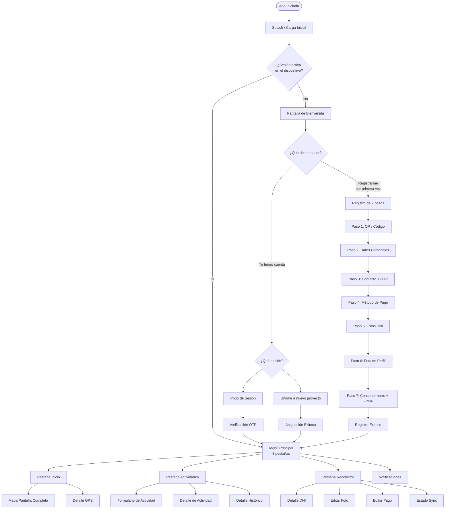

# Guía de Usuario Completa — Pachamama Mobile

<!-- indice:inicio -->

<details>
<summary><strong>Índice de contenido</strong></summary>

- [Mapa de Flujos y Especificación Funcional Detallada](#mapa-de-flujos-y-especificación-funcional-detallada)
- [Índice](#índice)
- [1. Diagrama General de Navegación](#1-diagrama-general-de-navegación)
- [2. Flujo de Inicio (Splash)](#2-flujo-de-inicio-splash)
  - [Elementos Visuales](#elementos-visuales)
  - [Secuencia de Mensajes](#secuencia-de-mensajes)
  - [Lógica de Decisión](#lógica-de-decisión)
  - [Duración](#duración)
  - [Condiciones Especiales](#condiciones-especiales)
- [3. Flujo de Bienvenida](#3-flujo-de-bienvenida)
  - [Elementos Visuales](#elementos-visuales-1)
  - [Opciones Disponibles](#opciones-disponibles)
  - [Comportamiento del Botón "Atrás"](#comportamiento-del-botón-atrás)
  - [Condiciones](#condiciones)
- [4. Flujo de Registro: Nuevo Recolector (7 pasos)](#4-flujo-de-registro-nuevo-recolector-7-pasos)
  - [Comportamiento General del Flujo](#comportamiento-general-del-flujo)
  - [4.1 Paso 1/7 — Escanear Código QR o Ingresar Código](#41-paso-17-escanear-código-qr-o-ingresar-código)
  - [4.2 Paso 2/7 — Datos Personales](#42-paso-27-datos-personales)
  - [4.3 Paso 3/7 — Información de Contacto](#43-paso-37-información-de-contacto)
  - [4.4 Paso 4/7 — Información de Pago](#44-paso-47-información-de-pago)
  - [4.5 Paso 5/7 — Captura de DNI (Fotos)](#45-paso-57-captura-de-dni-fotos)
  - [4.6 Paso 6/7 — Foto de Perfil](#46-paso-67-foto-de-perfil)
  - [4.7 Paso 7/7 — Consentimiento Informado + Firma](#47-paso-77-consentimiento-informado-firma)
  - [4.8 Pantalla de Registro Exitoso](#48-pantalla-de-registro-exitoso)
- [5. Flujo de Inicio de Sesión (Recolector Existente)](#5-flujo-de-inicio-de-sesión-recolector-existente)
  - [5.1 Login: DNI + Últimos 3 Dígitos](#51-login-dni-últimos-3-dígitos)
  - [5.2 Verificación OTP (Login)](#52-verificación-otp-login)
- [6. Flujo de Unirse a Nuevo Proyecto](#6-flujo-de-unirse-a-nuevo-proyecto)
  - [Pantalla de Opciones para Recolector Existente](#pantalla-de-opciones-para-recolector-existente)
  - [Pantalla de Unirse a Proyecto](#pantalla-de-unirse-a-proyecto)
  - [Pantalla de Asignación Exitosa](#pantalla-de-asignación-exitosa)
- [7. Menú Principal](#7-menú-principal)
  - [7.1 Barra Superior (Top Bar)](#71-barra-superior-top-bar)
  - [7.2 Barra Inferior (Bottom Navigation)](#72-barra-inferior-bottom-navigation)
  - [7.3 Estados Globales y Comportamientos Transversales](#73-estados-globales-y-comportamientos-transversales)
- [8. Pestaña Inicio (Dashboard)](#8-pestaña-inicio-dashboard)
  - [8.1 Resumen Operativo](#81-resumen-operativo)
  - [8.2 Mapa del Proyecto](#82-mapa-del-proyecto)
  - [8.3 Indicador de Ubicación y Geocerca](#83-indicador-de-ubicación-y-geocerca)
  - [8.4 Calidad de Señal GPS](#84-calidad-de-señal-gps)
- [9. Pestaña Actividades (Tareas)](#9-pestaña-actividades-tareas)
  - [9.1 Vista Principal: Pendientes e Historial](#91-vista-principal-pendientes-e-historial)
  - [9.2 Sección Pendientes](#92-sección-pendientes)
  - [9.3 Sección Historial](#93-sección-historial)
  - [9.4 Formulario de Registro de Actividad](#94-formulario-de-registro-de-actividad)
  - [9.5 Detalle de Actividad Pendiente](#95-detalle-de-actividad-pendiente)
  - [9.6 Detalle de Actividad Histórica](#96-detalle-de-actividad-histórica)
  - [9.7 Gestión de Multimedia y Borradores](#97-gestión-de-multimedia-y-borradores)
- [10. Pestaña Recolector (Perfil)](#10-pestaña-recolector-perfil)
  - [10.1 Cabecera del Perfil](#101-cabecera-del-perfil)
  - [10.2 Pestaña "Datos"](#102-pestaña-datos)
  - [10.3 Pestaña "Mis Pagos"](#103-pestaña-mis-pagos)
  - [10.4 Pestaña "Mi Comunidad"](#104-pestaña-mi-comunidad)
  - [10.5 Menú de Opciones](#105-menú-de-opciones)
- [11. Pantallas de Perfil Avanzadas](#11-pantallas-de-perfil-avanzadas)
  - [11.1 Detalle de DNI](#111-detalle-de-dni)
  - [11.2 Editar Foto de Perfil](#112-editar-foto-de-perfil)
  - [11.3 Actualizar Método de Pago](#113-actualizar-método-de-pago)
  - [11.4 Estado de Sincronización](#114-estado-de-sincronización)
- [12. Pantalla de Notificaciones](#12-pantalla-de-notificaciones)
  - [Acceso](#acceso)
  - [Elementos Visuales](#elementos-visuales-2)
  - [Estados](#estados)
  - [Comportamiento](#comportamiento)
- [13. Mapa del Proyecto (Pantalla Completa)](#13-mapa-del-proyecto-pantalla-completa)
  - [Acceso](#acceso-1)
  - [Elementos Visuales](#elementos-visuales-3)
  - [Funcionalidades](#funcionalidades)
  - [Estados del Mapa](#estados-del-mapa)
- [14. Sincronización de Datos](#14-sincronización-de-datos)
  - [¿Cómo funciona la sincronización?](#cómo-funciona-la-sincronización)
  - [¿Qué se sincroniza?](#qué-se-sincroniza)
  - [Estrategia de Sincronización](#estrategia-de-sincronización)
  - [Circuit Breaker (Protección de Recursos)](#circuit-breaker-protección-de-recursos)
- [15. Matriz Completa de Condiciones y Comportamientos](#15-matriz-completa-de-condiciones-y-comportamientos)
  - [Condiciones de Acceso y Sesión](#condiciones-de-acceso-y-sesión)
  - [Condiciones de Ubicación y GPS](#condiciones-de-ubicación-y-gps)
  - [Condiciones de Red y Conexión](#condiciones-de-red-y-conexión)
  - [Condiciones de Registro (Onboarding)](#condiciones-de-registro-onboarding)
  - [Condiciones de Actividades](#condiciones-de-actividades)
  - [Condiciones de Perfil](#condiciones-de-perfil)
- [16. Glosario de Términos](#16-glosario-de-términos)
- [17. Preguntas Frecuentes (FAQ)](#17-preguntas-frecuentes-faq)
  - [Acceso y Sesión](#acceso-y-sesión)
  - [Registro (Onboarding)](#registro-onboarding)
  - [Actividades](#actividades)
  - [Perfil](#perfil)
  - [Conexión y Sincronización](#conexión-y-sincronización)
  - [GPS y Ubicación](#gps-y-ubicación)

</details>
<!-- indice:fin -->

## Mapa de Flujos y Especificación Funcional Detallada

> **Versión:** 1.3.0  
> **Propósito:** Documentar todas las vistas, flujos, condiciones, validaciones, estados de error y lógica de navegación de la aplicación Pachamama Mobile para Android, con el fin de construir una guía de usuario exhaustiva y un mapa de flujos navegacionales.

---

## Índice

1. [Diagrama General de Navegación](#1-diagrama-general-de-navegación)
2. [Flujo de Inicio (Splash)](#2-flujo-de-inicio-splash)
3. [Flujo de Bienvenida](#3-flujo-de-bienvenida)
4. [Flujo de Registro: Nuevo Recolector (7 pasos)](#4-flujo-de-registro-nuevo-recolector-7-pasos)
   - 4.1 Paso 1: Escanear QR o Ingresar Código
   - 4.2 Paso 2: Datos Personales (DNI)
   - 4.3 Paso 3: Información de Contacto + OTP
   - 4.4 Paso 4: Información de Pago
   - 4.5 Paso 5: Captura de DNI (Fotos)
   - 4.6 Paso 6: Foto de Perfil
   - 4.7 Paso 7: Consentimiento Informado + Firma
   - 4.8 Pantalla de Registro Exitoso
5. [Flujo de Inicio de Sesión (Recolector Existente)](#5-flujo-de-inicio-de-sesión-recolector-existente)
   - 5.1 Login: DNI + Últimos 3 Dígitos
   - 5.2 Verificación OTP
6. [Flujo de Unirse a Nuevo Proyecto](#6-flujo-de-unirse-a-nuevo-proyecto)
7. [Menú Principal](#7-menú-principal)
   - 7.1 Barra Superior (Top Bar)
   - 7.2 Barra Inferior (Bottom Navigation)
   - 7.3 Estados Globales y Comportamientos Transversales
8. [Pestaña Inicio (Dashboard)](#8-pestaña-inicio-dashboard)
   - 8.1 Resumen Operativo
   - 8.2 Mapa del Proyecto
   - 8.3 Indicador de Ubicación y Geocerca
   - 8.4 Calidad de Señal GPS
9. [Pestaña Actividades (Tareas)](#9-pestaña-actividades-tareas)
   - 9.1 Vista Principal: Pendientes e Historial
   - 9.2 Sección Pendientes
   - 9.3 Sección Historial
   - 9.4 Formulario de Registro de Actividad
   - 9.5 Detalle de Actividad Pendiente
   - 9.6 Detalle de Actividad Histórica
   - 9.7 Gestión de Multimedia y Borradores
10. [Pestaña Recolector (Perfil)](#10-pestaña-recolector-perfil)
    - 10.1 Cabecera del Perfil
    - 10.2 Pestaña "Datos"
    - 10.3 Pestaña "Mis Pagos"
    - 10.4 Pestaña "Mi Comunidad"
    - 10.5 Menú de Opciones
11. [Pantallas de Perfil Avanzadas](#11-pantallas-de-perfil-avanzadas)
    - 11.1 Detalle de DNI
    - 11.2 Editar Foto de Perfil
    - 11.3 Actualizar Método de Pago
    - 11.4 Estado de Sincronización
12. [Pantalla de Notificaciones](#12-pantalla-de-notificaciones)
13. [Mapa del Proyecto (Pantalla Completa)](#13-mapa-del-proyecto-pantalla-completa)
14. [Sincronización de Datos](#14-sincronización-de-datos)
15. [Matriz Completa de Condiciones y Comportamientos](#15-matriz-completa-de-condiciones-y-comportamientos)
16. [Glosario de Términos](#16-glosario-de-términos)
17. [Preguntas Frecuentes (FAQ)](#17-preguntas-frecuentes-faq)

---

## 1. Diagrama General de Navegación



---

## 2. Flujo de Inicio (Splash)

**Propósito:** Pantalla de carga inicial que determina el estado de sesión del usuario y redirige al flujo correspondiente.

### Elementos Visuales
- Logo de Pachamama (centrado)
- Indicador de carga (animación circular)
- Mensajes de estado que cambian dinámicamente

### Secuencia de Mensajes
| Orden | Mensaje | Cuándo aparece |
|-------|---------|----------------|
| 1 | "Inicializando..." | Al abrir la app, mientras se preparan los componentes |
| 2 | "Cargando tu perfil..." | Si se detecta una sesión guardada, mientras se recuperan datos |
| 3 | "Preparando tu bienvenida..." | Si no hay sesión guardada |

### Lógica de Decisión
1. El sistema **revisa el almacenamiento local** del dispositivo para determinar si existe una sesión previa guardada
2. La sesión incluye: ID del recolector, ID del proyecto, token de autenticación, datos del perfil
3. **Si hay sesión activa y válida** → Navega directamente al **Menú Principal** (salta todo registro e inicio de sesión)
4. **Si NO hay sesión** → Navega a la **Pantalla de Bienvenida**

### Duración
- Mínimo ~2 segundos (tiempo de carga)
- Puede extenderse si hay que validar el token de sesión contra el servidor

### Condiciones Especiales
- **Token expirado:** Si el token JWT de sesión está expirado, se considera como "sin sesión" y se redirige a Bienvenida
- **Error de almacenamiento:** Si no se puede leer el almacenamiento, se muestra la pantalla de Bienvenida por seguridad
- **Primera instalación:** Siempre va a Bienvenida

---

## 3. Flujo de Bienvenida

**Propósito:** Punto de entrada para usuarios nuevos y existentes. Presenta las dos opciones principales de acceso.

### Elementos Visuales
- Logo de Pachamama
- Título de bienvenida
- Dos botones grandes con iconos

### Opciones Disponibles
| Botón | Acción | Flujo resultante |
|-------|--------|------------------|
| **"Registrarme por primera vez"** | Inicia el registro de nuevo recolector (7 pasos) | Navega a pantalla de Escaneo QR |
| **"Ya tengo cuenta"** | Acceso para recolectores existentes | Navega a pantalla de Opciones para Existente |

### Comportamiento del Botón "Atrás"
- No hay botón "Atrás" visible (es la primera pantalla del flujo de registro)
- Si el usuario presiona el botón físico de "Atrás" del dispositivo, la app se minimiza (va a segundo plano)

### Condiciones
- **Siempre se muestra** cuando no hay sesión activa
- No hay tiempo de espera ni expiración en esta pantalla

---

## 4. Flujo de Registro: Nuevo Recolector (7 pasos)

**Propósito:** Proceso completo de registro para un nuevo recolector de datos. Consta de 7 pasos secuenciales.

### Comportamiento General del Flujo
- **Navegación hacia atrás:** En cualquier paso, el botón "Atrás" vuelve al paso anterior
- **Pérdida de datos al salir:** Si el usuario sale completamente del flujo (presiona "Atrás" desde el Paso 1), **todos los datos temporales se borran**
- **Indicador de progreso:** Se muestra visualmente en qué paso de 7 se encuentra el usuario
- **Persistencia entre pasos:** Los datos ingresados se mantienen en memoria compartida mientras el usuario navega entre pasos

---

### 4.1 Paso 1/7 — Escanear Código QR o Ingresar Código

**Propósito:** Capturar el código de invitación del proyecto al que el recolector será asignado.

#### ¿Qué puede hacer el usuario?

**Opción A: Escanear código QR**
- Activa la cámara del dispositivo para escanear un código QR
- El código QR contiene la información del proyecto y comunidad
- La cámara se enfoca automáticamente en el código

**Opción B: Ingresar código manualmente**
- Campo de texto para ingresar un código de invitación de **6 caracteres**
- El código puede contener letras y números
- El botón "Validar" se habilita cuando se ingresan exactamente 6 caracteres

#### Validaciones y Condiciones

| Condición | Comportamiento |
|-----------|----------------|
| **Código válido** | Guarda la información del proyecto/comunidad y avanza al Paso 2 |
| **Código inválido** | Muestra mensaje de error: _"El código ingresado no es válido. Verifica e intenta de nuevo."_ |
| **Código vacío** | Botón de continuar deshabilitado |
| **Cámara sin permiso** | No se puede escanear; se informa al usuario y se sugiere usar ingreso manual |
| **Error de cámara** | Muestra mensaje y permite reintentar o usar ingreso manual |

#### Navegación
- **Atrás:** Vuelve a la pantalla de Bienvenida y **borra todos los datos** del registro iniciado
- **Adelante:** Solo cuando el código es válido

---

### 4.2 Paso 2/7 — Datos Personales

**Propósito:** Registrar la identidad del recolector mediante su DNI.

#### Campos del Formulario

| Campo | Tipo | Validación |
|-------|------|------------|
| **Número de DNI** | Texto (8 dígitos) | Requerido. Solo números. Exactamente 8 caracteres |
| **Nombres** | Texto | Se autocompletan al consultar DNI. Editables manualmente |
| **Apellidos** | Texto | Se autocompletan al consultar DNI. Editables manualmente |
| **Fecha de Nacimiento** | Fecha | Se autocompleta al consultar DNI. Formato DD/MM/AAAA |
| **Género** | Selección | Se autocompleta al consultar DNI. Opciones: Masculino, Femenino, Otro |
| **Autorización de consulta** | Checkbox | Requerido: _"Autorizo la consulta de mis datos en la base de datos de RENIEC"_ |

#### Flujo de Consulta de DNI

```
Usuario ingresa DNI (8 dígitos)
    → Presiona "Consultar" o automáticamente al completar
    → Indicador de carga: "Consultando datos..."
    → Éxito: → Los campos se autocompletan con datos de RENIEC
            → Usuario revisa y corrige si es necesario
            → Presiona "Continuar"
    → Error: → DNI no encontrado en base de datos externa
            → Usuario debe llenar TODOS los campos manualmente
    → Error de red: → Mensaje: "No se pudo conectar. Verifica tu conexión."
                     → Usuario puede llenar campos manualmente o reintentar

```

#### Validaciones Adicionales

| Condición | Comportamiento |
|-----------|----------------|
| **DNI repetido** | El sistema verifica que el DNI no esté ya registrado en otro recolector. Si existe, muestra: _"Este DNI ya se encuentra registrado"_ |
| **Datos consultados vs. editados** | Si el usuario modifica datos que vinieron de la consulta, se permite |
| **Retroceder desde pasos posteriores** | Si el usuario retrocede hasta este paso, los datos previamente ingresados se conservan |
| **Campos incompletos** | Botón "Continuar" deshabilitado hasta que todos los campos requeridos estén llenos |

---

### 4.3 Paso 3/7 — Información de Contacto

**Propósito:** Registrar y verificar el número de teléfono celular del recolector mediante un código SMS (OTP).

#### Campos del Formulario

| Campo | Tipo | Validación |
|-------|------|------------|
| **Número de celular** | Texto (9 dígitos) | Requerido. Solo números. Exactamente 9 dígitos. Debe ser un número válido del país |

#### Flujo de Verificación OTP

```
Paso A: Usuario ingresa número de celular (9 dígitos)
Paso B: Presiona "Enviar código de verificación"
Paso C: → Indicador de carga: "Enviando código..."
         → Éxito: Se envía SMS con código de 4 dígitos
                  → Campo de código OTP se habilita
                  → Inicia cuenta regresiva de vigencia (60 segundos)
         → Error de envío: Mensaje: "No se pudo enviar el código. Intenta de nuevo."
Paso D: Usuario ingresa código de 4 dígitos recibido por SMS
Paso E: Presiona "Validar código"
Paso F: → Código correcto: Avanza al siguiente paso
         → Código incorrecto: Mensaje: "Código incorrecto. Te quedan X intentos."
         → Código expirado: Mensaje: "El código ha expirado. Solicita uno nuevo."
```

#### Reglas del OTP

| Regla | Valor |
|-------|-------|
| **Longitud del código** | 4 dígitos |
| **Tiempo de vigencia** | 60 segundos (cuenta regresiva visible) |
| **Reintentos de verificación** | Máximo 3 intentos |
| **Reenvíos de código** | Máximo 3 reenvíos |
| **Tiempo entre reenvíos** | 30 segundos (el botón "Reenviar" se deshabilita durante este tiempo) |

#### Condiciones Especiales

| Situación | Comportamiento |
|-----------|----------------|
| **Teléfono ya registrado** | El sistema valida que el número no esté asociado a otro recolector |
| **Límite de intentos alcanzado (3)** | Vuelve a la pantalla de inicio de sesión (pierde datos de registro) |
| **Número inválido** | Mensaje: _"Ingresa un número de teléfono válido de 9 dígitos"_ |
| **Sin conexión para enviar OTP** | No se puede enviar; se muestra mensaje de error de red |

---

### 4.4 Paso 4/7 — Información de Pago

**Propósito:** Registrar el método de pago preferido del recolector para recibir sus compensaciones.

#### Métodos de Pago Disponibles

| Método | Datos Requeridos | Validación Especial |
|--------|-------------------|---------------------|
| **Efectivo** | Ninguno | Selección inmediata. No requiere más datos |
| **Transferencia Bancaria** | Banco, Número de cuenta, Tipo de cuenta | Banco no vacío. Cuenta: número válido. Tipo: Ahorros o Corriente |
| **Billetera Móvil** | Número de celular de billetera | Requiere verificación OTP adicional |

#### Comportamiento por Método Seleccionado

**Efectivo:**
- Al seleccionar, no aparecen campos adicionales
- Botón "Continuar" disponible inmediatamente

**Transferencia Bancaria:**
- Al seleccionar, aparecen los campos:
  - **Banco:** Campo de texto libre
  - **Número de cuenta:** Campo numérico
  - **Tipo de cuenta:** Selección (Ahorros / Corriente)
- Todos los campos deben estar llenos para habilitar "Continuar"

**Billetera Móvil:**
- Al seleccionar, aparece campo para número de celular de la billetera
- Al ingresar el número, se envía un código OTP al mismo (similar al Paso 3)
- **Debe verificar el OTP** para poder continuar
- Sin OTP validado, el botón "Continuar" permanece deshabilitado

#### Validaciones

| Condición | Comportamiento |
|-----------|----------------|
| **Ningún método seleccionado** | No se puede continuar |
| **Transferencia: datos incompletos** | Botón "Continuar" deshabilitado |
| **Billetera: OTP no validado** | Botón "Continuar" deshabilitado |
| **Billetera: OTP inválido** | No permite guardar; muestra error y permite reintentar |

---

### 4.5 Paso 5/7 — Captura de DNI (Fotos)

**Propósito:** Tomar fotografías del documento de identidad (anverso y reverso) como evidencia.

#### Elementos Visuales
- Dos recuadros: uno para **Anverso (Frente)** y otro para **Reverso (Dorso)**
- Cada recuadro tiene un botón de cámara y una vista previa
- Indicador visual de cuál lado falta capturar

#### Flujo de Captura

```
Paso 1: Presiona "Tomar foto" en el recuadro del ANVERSO
Paso 2: Se abre la cámara → Toma la foto → Se muestra vista previa
Paso 3: Presiona "Tomar foto" en el recuadro del REVERSO
Paso 4: Se abre la cámara → Toma la foto → Se muestra vista previa
Paso 5: Presiona "Continuar" (habilitado solo si ambos lados están capturados)
```

#### Condiciones

| Situación | Comportamiento |
|-----------|----------------|
| **Ambos lados capturados** | Botón "Continuar" habilitado |
| **Solo un lado capturado** | Botón "Continuar" deshabilitado |
| **Foto no clara** | Puede presionar la vista previa para repetir la foto de ese lado |
| **Cámara sin permiso** | Mensaje informativo; no se puede capturar |
| **Error de cámara** | Mensaje: _"Error al capturar la imagen. Intenta de nuevo."_ |

#### Información Técnica (para referencia del equipo)
- Las imágenes se redimensionan a máximo 1080px
- Se aplica una marca de agua semitransparente con texto
- Las imágenes se guardan en almacenamiento local persistente
- Se utiliza la cámara frontal o trasera según disponibilidad

---

### 4.6 Paso 6/7 — Foto de Perfil

**Propósito:** Tomar una selfie para la foto de perfil del recolector.

#### Elementos Visuales
- Vista previa de la cámara frontal (espejo)
- Círculo de recorte que muestra cómo quedará la foto
- Botón para tomar foto
- Botón para repetir si no gusta el resultado

#### Flujo de Captura

```
Paso 1: Presiona "Tomar foto"
Paso 2: Se activa la cámara frontal → Toma la selfie
Paso 3: Se muestra la foto tomada con vista previa circular
Paso 4: Opciones:
        → "Repetir" → Vuelve a tomar la foto
        → "Continuar" → Guarda y avanza al siguiente paso
```

#### Condiciones

| Situación | Comportamiento |
|-----------|----------------|
| **Foto capturada** | Botón "Continuar" habilitado |
| **Sin foto** | Botón "Continuar" deshabilitado |
| **Cámara sin permiso** | Mensaje informativo |
| **Repetir foto** | No hay límite de repeticiones |

---

### 4.7 Paso 7/7 — Consentimiento Informado + Firma

**Propósito:** Leer, aceptar y firmar el consentimiento informado para participar como recolector.

#### Elementos de la Pantalla
- **Documento de consentimiento** (texto largo desplazable)
- **Casilla de verificación:** _"He leído y acepto los términos del consentimiento informado"_
- **Área de firma:** Recuadro para dibujar la firma con el dedo
- **Botón "Limpiar firma":** Borra la firma actual para volver a dibujarla
- **Botón "Finalizar":** Completa el registro (habilitado solo cuando todo está listo)

#### Requisitos para Finalizar

| Requisito | Estado |
|-----------|--------|
| Leer el documento | Se registra el desplazamiento (scroll) como evidencia |
| Marcar casilla de aceptación | **Obligatorio** |
| Dibujar firma en el recuadro | **Obligatorio** — La firma debe tener trazos detectables |

#### Flujo de Finalización

```
Paso 1: Leer el documento de consentimiento (desplazarse)
Paso 2: Marcar la casilla de aceptación
Paso 3: Dibujar la firma con el dedo
       → Si comete un error, presiona "Limpiar firma" para reiniciar
Paso 4: Presiona "Finalizar"
Paso 5: → Indicador de carga: "Enviando tu información..."
        → Éxito: Navega a la pantalla de Registro Exitoso
        → Error: Muestra mensaje de error con opción de reintentar
```

#### Comportamiento de "Cancelar"

| Acción | Resultado |
|--------|-----------|
| Presionar "Cancelar" | Se cancela TODO el registro |
| | Vuelve a la pantalla de Bienvenida |
| | TODOS los datos ingresados en los 7 pasos se pierden |
| **No hay confirmación** | La cancelación es inmediata (sin diálogo de confirmación) |

#### Cifrado y Seguridad
- El consentimiento firmado se envía **cifrado** al servidor
- Se utiliza la clave pública del servidor para el cifrado
- Si el cifrado falla, se guarda localmente como pendiente para reintentar después

---

### 4.8 Pantalla de Registro Exitoso

**Propósito:** Confirmar que el registro se completó y mostrar la asignación del recolector.

#### Elementos Visuales
- Animación de palomita (checkmark animado)
- Mensaje de felicitaciones: _"¡Registro completado!"_
- Nombre completo del recolector
- Información de asignación:
  - **Proyecto:** Nombre del proyecto asignado
  - **Comunidad:** Nombre de la comunidad asignada
- Estado del registro (con icono):
  - ✅ **Completado** — Registro exitoso
  - ⏳ **Pendiente** — En procesamiento
  - ❌ **Fallido** — Error en el servidor
- Botón "Continuar" para ir al Menú Principal

#### Estados de Validación Final

| Estado | Comportamiento |
|--------|----------------|
| **Completado** | El sistema confirma que el registro fue procesado correctamente. Botón "Continuar" disponible |
| **Pendiente** | El servidor aún está procesando. Se muestra mensaje: _"Tu registro está siendo procesado. Esto puede tomar unos momentos."_ Se reintenta automáticamente cada 2 segundos (máximo 60 intentos = 2 minutos) |
| **Fallido** | Mensaje de error: _"Hubo un problema al procesar tu registro. Intenta de nuevo más tarde."_ Botón para reintentar |

#### Condiciones Post-Registro

| Situación | Comportamiento |
|-----------|----------------|
| **Registro exitoso** | La sesión queda guardada automáticamente. No tendrá que volver a registrarse |
| **Error de servidor** | Se guarda la intención de registro para reintentar cuando haya conexión |
| **Presiona "Continuar"** | Navega al Menú Principal y limpia el historial de navegación (no puede volver atrás) |

---

## 5. Flujo de Inicio de Sesión (Recolector Existente)

**Propósito:** Permitir que un recolector ya registrado acceda a su cuenta.

---

### 5.1 Login: DNI + Últimos 3 Dígitos

#### Campos del Formulario

| Campo | Tipo | Validación |
|-------|------|------------|
| **Número de DNI** | Texto (8 dígitos) | Requerido. Solo números. Exactamente 8 caracteres |
| **Últimos 3 dígitos del celular** | Texto (3 dígitos) | Requerido. Solo números. Exactamente 3 caracteres |

#### Comportamiento del Botón "Iniciar Sesión"

| Condición | Estado del Botón |
|-----------|------------------|
| Ambos campos vacíos | ❌ Deshabilitado |
| DNI incompleto | ❌ Deshabilitado |
| Últimos 3 dígitos incompletos | ❌ Deshabilitado |
| **Ambos campos completos y válidos** | ✅ Habilitado |

#### Flujo de Validación

```
Paso 1: Ingresar DNI (8 dígitos)
Paso 2: Ingresar últimos 3 dígitos del celular
Paso 3: Presionar "Iniciar Sesión"
Paso 4: → Indicador de carga: "Verificando credenciales..."
        → Éxito: → El sistema envía un código OTP al celular registrado
                 → Navega a pantalla de verificación OTP
        → Error: → Credenciales incorrectas
                 → Mensaje: "DNI o últimos dígitos incorrectos. Verifica e intenta de nuevo."
                 → Contador de intentos fallidos
```

#### Control de Intentos Fallidos

| Intento Fallido | Comportamiento |
|-----------------|----------------|
| 1-2 | Mensaje de error normal |
| 3 | Mensaje de error + vuelve a la pantalla de Bienvenida |
| Más de 3 en un período corto | Bloqueo temporal (el sistema no permite nuevos intentos por un tiempo) |

---

### 5.2 Verificación OTP (Login)

**Propósito:** Verificar la identidad del usuario mediante un código SMS de 4 dígitos.

#### Elementos Visuales
- Mensaje: _"Te hemos enviado un código de verificación al celular registrado"_
- 4 recuadros individuales para cada dígito del código
- Cuenta regresiva visible del tiempo de vigencia del código
- Botón "Reenviar código" (deshabilitado durante la cuenta regresiva)
- Botón "Validar código" (se habilita al ingresar los 4 dígitos)
- Indicador de intentos restantes

#### Reglas del OTP

| Regla | Valor |
|-------|-------|
| **Longitud del código** | 4 dígitos |
| **Tiempo de vigencia** | 60 segundos |
| **Reintentos de verificación** | Máximo 3 |
| **Reenvíos de código** | Máximo 3 |
| **Tiempo entre reenvíos** | 30 segundos |

#### Flujo de Verificación

```
Usuario recibe SMS con código de 4 dígitos
    → Ingresa cada dígito en los recuadros
    → Botón "Validar código" se habilita
    → Presiona "Validar código"
    
    → Éxito: → Mensaje: "Verificación exitosa"
             → Navega automáticamente al Menú Principal
    
    → Código incorrecto: → Mensaje: "Código incorrecto. Te quedan X intentos."
                         → Los recuadros se limpian para reintentar
    
    → Código expirado: → Mensaje: "El código ha expirado."
                        → Botón "Reenviar código" disponible
                        → Al reenviar, se envía un nuevo código y reinicia el contador
    
    → 3 intentos fallidos: → Mensaje: "Has agotado los intentos. Vuelve a iniciar sesión."
                            → Navega de vuelta a la pantalla de Login
```

#### Condiciones Especiales

| Situación | Comportamiento |
|-----------|----------------|
| **Reenviar código** | Se envía un nuevo SMS con un código diferente. Se reinicia el contador de vigencia |
| **Límite de reenvíos alcanzado** | Botón "Reenviar" se deshabilita permanentemente. Debe iniciar sesión de nuevo |
| **Sin conexión** | No se puede enviar el código. Mensaje: _"Sin conexión. Verifica tu conexión a internet."_ |
| **Código incorrecto en el último intento** | Vuelve automáticamente a login sin opción a reenviar |

---

## 6. Flujo de Unirse a Nuevo Proyecto

**Propósito:** Permitir que un recolector existente se una a un nuevo proyecto mediante código de invitación.

### Pantalla de Opciones para Recolector Existente

Se muestra después de presionar "Ya tengo cuenta" en Bienvenida.

| Opción | Descripción |
|--------|-------------|
| **Iniciar Sesión** | Acceder a la cuenta actual con DNI + 3 dígitos |
| **Unirme a Nuevo Proyecto** | Ingresar a un proyecto diferente al actual |

### Pantalla de Unirse a Proyecto

#### Métodos de Ingreso

| Método | Descripción |
|--------|-------------|
| **Escanear QR** | Usar la cámara para escanear el código QR del nuevo proyecto |
| **Ingresar código manual** | Escribir el código de invitación de 6 caracteres |

#### Flujo de Asignación

```
Paso 1: Escanear QR o ingresar código manual
Paso 2: → Indicador de carga: "Validando código..."
        → Código válido: Muestra información del proyecto:
                         - Nombre del proyecto
                         - Nombre de la comunidad
                         → Botón: "Unirme a este proyecto"
        → Código inválido: Mensaje de error
Paso 3: Presiona "Unirme a este proyecto"
Paso 4: → Indicador de carga: "Asignándote al proyecto..."
        → Éxito: Navega a la pantalla de Asignación Exitosa
        → Error: Mensaje de error con opción de reintentar
```

### Pantalla de Asignación Exitosa

#### Elementos Visuales
- Icono de éxito (palomita)
- Mensaje: _"¡Te has unido exitosamente!"_
- **Proyecto:** Nombre del proyecto
- **Comunidad:** Nombre de la comunidad
- Mensaje informativo: _"Un supervisor completará la asignación de tu brigada más adelante."_
- Botón "Continuar" para ir al Menú Principal

#### Condiciones

| Situación | Comportamiento |
|-----------|----------------|
| **Asignación exitosa** | La sesión se actualiza con los nuevos datos del proyecto |
| **Error de asignación** | Mensaje de error. Opción de reintentar |
| **Presiona "Continuar"** | Navega al Menú Principal. El backstack se limpia (no puede volver a esta pantalla) |

---

## 7. Menú Principal

**Propósito:** Navegación principal de la aplicación con 3 pestañas y elementos de interfaz global.

### 7.1 Barra Superior (Top Bar)

| Elemento | Visible en | Comportamiento |
|----------|------------|----------------|
| **Logo de Pachamama** | Siempre | Indicador visual de la app |
| **Icono de notificaciones (campana)** | Siempre | Presionar → abre pantalla de Notificaciones. Muestra **punto rojo** cuando hay notificaciones sin leer |
| **Icono de sincronización** | Solo en pestaña Inicio | Presionar → fuerza sincronización manual de datos |
| **Menú de opciones (3 puntos)** | Solo en pestaña Recolector | Presionar → abre menú desplegable con opciones de perfil |

### 7.2 Barra Inferior (Bottom Navigation)

| Pestaña | Icono | Nombre | Descripción |
|---------|-------|--------|-------------|
| 1 | 🏠 | **Inicio** | Dashboard con resumen operativo y mapa |
| 2 | 📋 | **Actividades** | Lista de tareas pendientes e historial |
| 3 | 👤 | **Recolector** | Perfil del usuario |

### 7.3 Estados Globales y Comportamientos Transversales

#### Cuenta Archivada

| Situación | Comportamiento |
|-----------|----------------|
| **Estado = Archivada** | Al intentar ingresar al Menú Principal, aparece un **diálogo forzoso** (no se puede cerrar ni ignorar) |
| | Mensaje: _"Tu cuenta ha sido archivada. Por favor, contacta con tu supervisor."_ |
| | La única acción posible es **"Aceptar y cerrar sesión"** |
| | Después de cerrar sesión, vuelve a la pantalla de Bienvenida |

#### Estado de Conexión

| Estado | Indicador | Comportamiento |
|--------|-----------|----------------|
| **Conectado** | No hay indicador negativo | Sincronización normal |
| **Sin conexión** | Mensaje en barra superior o notificación | _"Sin conexión. Los datos se enviarán cuando recuperes señal."_ |
| **Conexión débil** | El sistema detecta baja calidad de red | Las operaciones pueden ser más lentas |

#### Estado del Recolector

| Estado | Visible en Perfil | Efecto en la App |
|--------|-------------------|------------------|
| **Activo** | Etiqueta verde "Activo" | Operación normal |
| **Inactivo** | Etiqueta amarilla "Inactivo" | No puede crear nuevas actividades. Solo puede ver información |
| **Archivado** | Etiqueta roja "Archivado" | Diálogo forzoso de cierre de sesión |

---

## 8. Pestaña Inicio (Dashboard)

**Propósito:** Mostrar un resumen de la información operativa del recolector y el área del proyecto.

### 8.1 Resumen Operativo

#### Saludo Personalizado
- _"¡Hola, [Nombre del Recolector]!"_
- _"Gracias por tu colaboración"_

#### Tarjetas Informativas

| Tarjeta | Descripción | Origen |
|---------|-------------|--------|
| **Proyecto** | Nombre del proyecto activo | Datos de sesión |
| **Estado** | Etapa del proyecto (Ej: "Inventario", "Recolección") | Sincronizado del servidor |
| **Comunidad** | Nombre de la comunidad asignada | Datos de sesión |
| **Brigada** | Nombre de la brigada (si aplica) | Sincronizado del servidor |
| **Solicitud** | Código de solicitud de recolección (si aplica) | Sincronizado del servidor |

#### Estados de Carga

| Estado | Mensaje | Acción |
|--------|---------|--------|
| **Cargando** | "Cargando información del proyecto..." | Indicador de carga circular |
| **Error** | "No se pudo cargar la información." | Botón "Reintentar" |
| **Sin datos** | "No hay información del proyecto disponible." | Ninguna |
| **Datos cargados** | Tarjetas informativas visibles | Ninguna |

#### Estado de Sincronización en el Dashboard

| Situación | Indicador |
|-----------|-----------|
| Sincronizando | Mensaje: "Sincronizando..." con indicador animado |
| Error de sincronización | Mensaje de error con el tipo de fallo |
| Actividades pendientes | Conteo: "X actividades pendientes de envío" |
| Todo sincronizado | Sin mensaje (estado normal) |

### 8.2 Mapa del Proyecto

#### Elementos Visuales
- Vista previa del mapa dentro de una tarjeta
- Límites del proyecto (polígono) dibujados en el mapa
- Ubicación actual del usuario (marcador azul)
- Botón "Expandir" para ver en pantalla completa

#### Estados del Mapa

| Estado | Comportamiento |
|--------|----------------|
| **Inicializando** | "Preparando mapa..." |
| **Cargando** | "Cargando mapa del proyecto..." con indicador |
| **Cargado** | Mapa visible con polígonos del proyecto |
| **Error de carga** | Mensaje: "No se pudo cargar el mapa." Botón "Reintentar" |
| **Sin datos de mapa** | Mensaje: "No hay datos del mapa para este proyecto." |

### 8.3 Indicador de Ubicación y Geocerca

#### Estados de Ubicación

| Estado | Indicador Visual | Descripción |
|--------|------------------|-------------|
| **Dentro del área** | Icono verde + texto: _"Estás dentro del área del proyecto"_ | Puede registrar actividades |
| **Fuera del área** | Icono rojo + texto: _"Estás fuera del área del proyecto"_ | No puede registrar actividades directamente |
| **Verificando ubicación** | Indicador de carga | El sistema está obteniendo la ubicación GPS |
| **GPS desactivado** | Icono de advertencia | _"El GPS está desactivado. Actívalo en Configuración."_ |
| **Error de ubicación** | Icono de error | _"No se pudo obtener tu ubicación. Verifica el GPS."_ |

### 8.4 Calidad de Señal GPS

#### Acceso
- Botón "Ver detalles" en la tarjeta de ubicación

#### Información Mostrada

| Indicador | Rango | Descripción |
|-----------|-------|-------------|
| **Calidad** | Excelente | Precisión menor a 5 metros |
| | Buena | Precisión entre 5 y 15 metros |
| | Regular | Precisión entre 15 y 30 metros |
| | Mala | Precisión entre 30 y 50 metros |
| | Muy Mala | Precisión mayor a 50 metros |
| **Precisión** | — | Valor numérico en metros |
| **Coordenadas** | — | Latitud y longitud actuales |
| **Tiempo de monitoreo** | — | Tiempo transcurrido desde que inició el monitoreo |

#### Controles

| Botón | Acción |
|-------|--------|
| **"Iniciar toma"** | Comienza a monitorear la calidad GPS en tiempo real |
| **"Detener"** | Detiene el monitoreo |

---

## 9. Pestaña Actividades (Tareas)

**Propósito:** Gestionar todas las actividades de recolección de datos del recolector.

### 9.1 Vista Principal: Pendientes e Historial

#### Estructura
- **Dos secciones** separadas por pestañas o división visual
- Botón flotante "+" para crear nueva actividad (esquina inferior derecha)

### 9.2 Sección Pendientes

#### Estados de las Actividades

| Estado | Icono/Color | Descripción | Acciones Disponibles |
|--------|-------------|-------------|---------------------|
| **Borrador** | 📝 Amarillo | Guardaste la actividad pero no la has completado | Continuar editando, Eliminar |
| **Pendiente de envío** | ⏳ Naranja | Completaste la actividad pero no se ha enviado | Ver detalle, Sincronizar |
| **Enviando...** | 🔄 Azul | Se está subiendo al servidor | Esperar |
| **Error al enviar** | ❌ Rojo | Falló el envío (con número de intentos) | Reintentar, Ver detalle |
| **Enviado** | ✅ Verde | Ya está en el servidor | Ver detalle (solo lectura) |

#### Información por Actividad
- **Código de unidad forestal** (árbol/troza)
- **Fecha y hora** de registro
- **Tipo** (Inventario / Recolección)
- **Estado** actual (con icono de color)

#### Acciones Disponibles

| Acción | Cómo se realiza | Comportamiento |
|--------|-----------------|----------------|
| **Continuar borrador** | Presionar actividad con estado "Borrador" | Abre el formulario con los datos guardados |
| **Ver detalle** | Presionar actividad enviada o con error | Abre pantalla de detalle |
| **Eliminar borrador** | Presionar icono de eliminar (papelera) | Diálogo de confirmación: _"¿Eliminar borrador? Esta acción no se puede deshacer."_ Al confirmar, se borra la actividad y toda su multimedia asociada |
| **Sincronizar** | Presionar icono de sincronización en la actividad | Intenta enviar la actividad al servidor |
| **Sincronizar Todo** | Botón en la parte superior | Envía TODAS las actividades pendientes (solo si hay conexión) |

#### Botón "+" (Agregar Nueva Actividad)

**Visibilidad del botón:**

| Condición | ¿Botón visible? |
|-----------|-----------------|
| Recolector **Activo** + **Dentro del área** | ✅ Sí |
| Recolector **Activo** + **Fuera del área** | ❌ No (muestra advertencia) |
| Recolector **Inactivo** | ❌ No (muestra advertencia) |
| **Verificando ubicación** | ❌ No (muestra indicador de carga) |
| **Error de ubicación** | ❌ No (muestra mensaje de error) |

**Diálogo de selección de tipo de actividad:**

Al presionar "+":
1. Aparece un diálogo con las opciones disponibles según el proyecto:
   - **"Inventario"** — Si está habilitado para el proyecto actual
   - **"Recolección"** — Si está habilitado para el proyecto actual
2. Al seleccionar un tipo, se abre el **Formulario de Registro de Actividad**

#### Mensajes de Advertencia en Pendientes

| Situación | Mensaje |
|-----------|---------|
| **Sin conexión** | "Sin conexión. Tu información se enviará cuando recuperes señal." |
| **Fuera del área** | "No puedes crear actividades porque estás fuera del área del proyecto." |
| **Recolector inactivo** | "No puedes realizar nuevas actividades. Contacta a tu supervisor." |
| **Actividad con error** | "Error al enviar. Intento X de 3." |
| **Sin actividades pendientes** | "No tienes actividades pendientes." |

### 9.3 Sección Historial

**Propósito:** Ver actividades que ya fueron enviadas al servidor.

#### Filtro por Fecha
- Botones de navegación: **← Día anterior** y **Día siguiente →**
- La fecha se muestra en formato completo: _"lunes, 21 de mayo de 2026"_
- **No se puede navegar a una fecha futura**
- Los botones de día siguiente se deshabilitan al llegar a la fecha actual

#### Estados de la Sección Historial

| Estado | Mensaje | Acción |
|--------|---------|--------|
| **Cargando** | "Cargando historial..." | Indicador de carga |
| **Sin conexión** | "No hay datos para mostrar. Se consultarán automáticamente cuando mejore la conexión." | Ninguna |
| **Error de conexión** | "Error al cargar el historial." | Botón "Reintentar" |
| **Sin actividades** | "No hay actividades registradas en esta fecha." | Ninguna |
| **Actividades cargadas** | Lista de actividades con fecha, hora, tipo | Presionar para ver detalle |

#### Información de cada Actividad en Historial
- **Código de unidad forestal**
- **Fecha y hora** de registro
- **Tipo** (Inventario / Recolección)
- **Etapa del proyecto**
- **Estado de validación:** Pendiente / Aprobado / Rechazado

### 9.4 Formulario de Registro de Actividad

**Propósito:** Capturar información detallada de una unidad forestal (árbol o troza) mediante un formulario dinámico.

#### Parte 1: Información de la Unidad Forestal

**Comportamiento según la etapa del proyecto:**

| Etapa del Proyecto | Comportamiento |
|--------------------|----------------|
| **INVENTARIO** | Ingresa el **código de la unidad forestal** manualmente. La opción "¿Es troza?" está deshabilitada (no aplica) |
| **RECOLECCIÓN** | Automáticamente se marca como **"troza"**. Debes ingresar: 1) **Código de la unidad (Troza)**, 2) **Unidad forestal padre** — Toca el campo para buscar y seleccionar el árbol padre |

**Selector de Unidad Forestal Padre (solo en RECOLECCIÓN):**
1. Toca el campo "Unidad forestal padre"
2. Se abre una pantalla de selección con lista de unidades disponibles
3. Puedes **buscar por nombre** usando el campo de búsqueda
4. También puedes **desplazarte por la lista**
5. Presiona la unidad deseada para seleccionarla
6. Vuelve al formulario con el dato seleccionado

#### Parte 2: Formulario Dinámico

El formulario se genera automáticamente según la configuración del servidor. Puede incluir:

| Tipo de Campo | Descripción | Comportamiento |
|---------------|-------------|----------------|
| **Texto** | Para escribir información breve | Campo de texto libre |
| **Número** | Para valores numéricos | Teclado numérico. Validación de rango si está configurada |
| **Fecha y Hora** | Para fechas y horas específicas | Selector de fecha y hora |
| **Sí/No** | Interruptor de opción binaria | Switch deslizable |
| **Selección única** | Elegir una opción de varias | Lista desplegable o radio buttons |
| **Foto** | Tomar una fotografía como evidencia | Abre la cámara. Se puede repetir |
| **Video** | Grabar un video como evidencia | Abre la cámara en modo video |
| **Selfie** | Tomarse una selfie | Abre la cámara frontal |
| **Firma digital** | Dibujar firma con el dedo | Área de dibujo similar al consentimiento |
| **Ubicación GPS** | Capturar coordenadas actuales | Captura automática de latitud/longitud |

#### Parte 3: Acciones del Formulario

| Botón | Acción | Condición |
|-------|--------|-----------|
| **"Guardar borrador"** | Guarda el avance sin enviar | Siempre disponible (aunque haya campos incompletos) |
| **"Registrar actividad"** | Valida y guarda para enviar | Solo cuando los campos obligatorios están completos |

#### Flujo de "Registrar Actividad"

```
Usuario presiona "Registrar actividad"
    → 1. Validar campos obligatorios:
        → Incompletos: Muestra qué campos faltan. No continúa
        → Completos: Continúa
    → 2. Validar ubicación (geocerca):
        → Dentro del área: Guarda la actividad como "Pendiente de envío". 
                           Muestra: "Actividad registrada correctamente."
        → Fuera del área: Muestra diálogo:
            "Te encuentras fuera del área del proyecto. 
             Distancia: X km.
             ¿Deseas continuar de todas formas?"
            Opciones: "Continuar" (guarda igual) / "Cancelar" (no guarda)
    → 3. Si todo es correcto, la actividad se guarda localmente y se agenda para sincronizar
```

#### Auto-guardado del Formulario

| Evento | Comportamiento |
|--------|----------------|
| **Cada 5 minutos** | Si hay cambios desde el último guardado, se guarda automáticamente. Muestra toast: _"Guardado automáticamente"_ |
| **App pasa a segundo plano** | Se guarda automáticamente sin mostrar mensaje |
| **Usuario intenta salir sin guardar** | Si hay cambios sin guardar: diálogo _"¿Deseas guardar el borrador?"_ con opciones: Guardar / Salir sin guardar / Cancelar |
| **Usuario sale sin cambios** | No hay diálogo, la salida es directa |

#### Manejo de Multimedia en el Formulario

- Cuando el usuario agrega una foto, video, selfie o firma, el archivo se guarda **inmediatamente en almacenamiento persistente**
- El archivo queda vinculado al ID de la actividad desde el momento de captura
- Si el usuario guarda como borrador y vuelve después, la multimedia sigue disponible
- Si se elimina el borrador, toda la multimedia asociada se elimina también

### 9.5 Detalle de Actividad Pendiente

**Propósito:** Ver la información completa de una actividad que aún no ha sido enviada.

#### Información Mostrada
- **Código de unidad forestal**
- **Fecha y hora** de registro
- **Tipo** (Inventario / Recolección)
- **Estado de sincronización** con detalle
- **Respuestas del formulario** (todos los campos)
- **Evidencias multimedia** (fotos, videos, selfies, firmas)
- **Ubicación** donde se registró (en mapa, si tiene coordenadas)
- **Error de sincronización** (si aplica) y número de intentos fallidos
- Último error recibido del servidor (si hay)

#### Acciones
- **"Reintentar envío"** — Si la actividad tiene error de sincronización
- **"Volver"** — Regresa a la lista de pendientes

### 9.6 Detalle de Actividad Histórica

**Propósito:** Ver la información de una actividad ya enviada al servidor.

#### Información Mostrada
- **Fecha de registro** en el dispositivo
- **Fecha de sincronización** con el servidor
- **Etapa del proyecto** (Inventario / Recolección)
- **Estado de validación:** Pendiente / Aprobado / Rechazado
- **Respuestas del formulario** (todos los campos)
- **Evidencias multimedia** (fotos, videos, selfies, firmas)
- **Ubicación** en mapa (si hay coordenadas)

#### Condiciones
- **Solo lectura** — No se puede editar
- **Requiere conexión** para cargar datos completos del historial
- Sin conexión: muestra mensaje de error

### 9.7 Gestión de Multimedia y Borradores

#### Flujo de Captura y Persistencia de Multimedia

```
Usuario agrega foto/video/selfie/firma en el formulario
    → El archivo se copia a almacenamiento persistente (no temporal)
    → Se registra en la base de datos local vinculado a la actividad
    → La evidencia sobrevive a:
        - Cierre de la aplicación
        - Pérdida de conexión
        - Guardado como borrador y reapertura
```

#### Ciclo de Vida de un Borrador

```
                ┌──────────────┐
                │  Nuevo       │
                │  Formulario  │
                └──────┬───────┘
                       │
                ┌──────▼───────┐
                │  En Edición  │
                └──────┬───────┘
                       │
            ┌──────────┼──────────┐
            │          │          │
    ┌───────▼────┐ ┌──▼───┐ ┌───▼────────┐
    │ Guardar    │ │ Auto │ │ App a       │
    │ Manual     │ │ 5min │ │ 2do plano   │
    └───────┬────┘ └──┬───┘ └───┬────────┘
            │          │          │
            └──────────┼──────────┘
                       │
                ┌──────▼───────┐
                │  Borrador    │
                │  Guardado    │
                └──────┬───────┘
                       │
            ┌──────────┼──────────┐
            │          │          │
    ┌───────▼────┐ ┌──▼───┐ ┌───▼────────┐
    │ Reabrir    │ │ Com- │ │ Eliminar   │
    │ (editar)   │ │pletar│ │ (confirma) │
    └───────┬────┘ └──┬───┘ └───┬────────┘
            │          │          │
            └──────────┤          └──► Eliminado
                       │
                ┌──────▼───────┐
                │  Pendiente   │
                │  de Envío    │
                └──────┬───────┘
                       │
                ┌──────▼───────┐
                │  Sincronizado│
                │  (Servidor)  │
                └──────────────┘
```

---

## 10. Pestaña Recolector (Perfil)

**Propósito:** Ver y editar la información personal del recolector.

### 10.1 Cabecera del Perfil

#### Elementos
- **Foto de perfil** (circular). Si no tiene, se muestra iniciales o icono por defecto
- **Nombre completo**
- **Comunidad** asignada
- **Estado:** Activo / Inactivo / Archivado (con etiqueta de color)

#### Estados de Carga

| Estado | Mensaje |
|--------|---------|
| **Cargando** | "Cargando tu perfil..." |
| **Error** | "No se pudo cargar la información del perfil." + Botón "Reintentar" |

### 10.2 Pestaña "Datos"

#### Información Personal

| Campo | Valor | Acción |
|-------|-------|--------|
| **Tipo de documento** | "DNI" | Solo informativo |
| **Número de documento** | Número con formato | Presiona la **flecha** (→) para **ver o actualizar fotos del DNI** |
| **Fecha de nacimiento** | DD/MM/AAAA | Solo informativo |
| **Género** | Texto | Solo informativo |
| **Edad** | Número calculado | Solo informativo |

#### Información de Contacto

| Campo | Valor |
|-------|-------|
| **Teléfono** | Número de celular registrado |

### 10.3 Pestaña "Mis Pagos"

#### Información Mostrada

| Método de Pago | Detalles que se muestran |
|----------------|--------------------------|
| **Efectivo** | "Efectivo" |
| **Transferencia Bancaria** | Banco, Número de cuenta (parcialmente oculto: *****1234), Tipo de cuenta |
| **Billetera Móvil** | Número de billetera (parcialmente oculto) |

#### Acciones
- Botón **"Editar"** → Abre la pantalla de Actualizar Método de Pago
- Si no hay método configurado: mensaje _"No has configurado un método de pago"_ + botón "Agregar"

### 10.4 Pestaña "Mi Comunidad"

#### Tu Asignación

| Dato | Descripción |
|------|-------------|
| **Proyecto** | Nombre del proyecto actual |
| **Comunidad** | Nombre de la comunidad asignada |

#### Asignaciones de Brigada

| Información | Descripción |
|-------------|-------------|
| **Nombre de la brigada** | Identificador del grupo |
| **Solicitud** | Código de solicitud asociada |
| **Tipo** | Rol dentro de la brigada |
| **Período** | Fecha de inicio y fin de asignación |
| **Estado** | Activo / Archivado |
| **Brigada actual** | Marcada con una estrella ⭐ y resaltada visualmente |

#### Estados de Brigadas

| Estado | Mensaje |
|--------|---------|
| **Cargando** | "Cargando asignaciones..." |
| **Sin asignaciones** | "No tienes asignaciones de brigada." |
| **Lista cargada** | Muestra las asignaciones con su detalle |

### 10.5 Menú de Opciones

**Acceso:** Icono de 3 puntos (⋮) en la barra superior de la pestaña Recolector.

| Opción | Acción |
|--------|--------|
| **Estado de sincronización** | Abre pantalla de detalle de sincronización |
| **Editar foto de perfil** | Abre pantalla para tomar nueva selfie |
| **Cerrar sesión** | Inicia el proceso de cierre de sesión |

#### Flujo de Cierre de Sesión

```
Presiona "Cerrar sesión"
    → ¿Hay actividades pendientes de envío?
    
    → SÍ: → Diálogo de advertencia:
           "Tienes actividades pendientes que no se han enviado.
            Si cierras sesión, perderás los datos locales no sincronizados."
           Opciones:
           - "Borrar datos y cerrar sesión" → Elimina datos locales, cierra sesión, vuelve al Splash
           - "Cancelar" → No hace nada, vuelve al perfil
    
    → NO: → Diálogo de confirmación simple:
           "¿Estás seguro de que deseas cerrar sesión?"
           Opciones:
           - "Cerrar sesión" → Cierra sesión, vuelve al Splash
           - "Cancelar" → No hace nada, vuelve al perfil
```

---

## 11. Pantallas de Perfil Avanzadas

### 11.1 Detalle de DNI

**Propósito:** Ver y actualizar las fotografías del DNI.

#### Elementos Visuales
- **Foto del Anverso (Frente)** — Imagen grande, se puede hacer zoom
- **Foto del Reverso (Dorso)** — Imagen grande, se puede hacer zoom
- Botón de cámara en cada foto para recapturar

#### Estados

| Estado | Comportamiento |
|--------|----------------|
| **Cargando** | Indicador de carga mientras se descargan las imágenes |
| **Foto no disponible** | Mensaje: _"No hay foto disponible"_ + botón para tomar |
| **Foto disponible** | Imagen visible con opción de recapturar |
| **Error al cargar** | Mensaje de error + botón "Reintentar" |
| **Recapturando** | Abre la cámara para tomar nueva foto del lado seleccionado |

#### Flujo de Recaptura

```
Presiona el botón de cámara en la foto que desea actualizar
    → Se abre la cámara
    → Toma la nueva foto
    → Se muestra vista previa
    → Presiona "Guardar" o "Repetir"
    → Al guardar, se actualiza la imagen local y se agenda para sincronizar
```

### 11.2 Editar Foto de Perfil

**Propósito:** Actualizar la selfie del perfil.

#### Elementos Visuales
- Vista previa de la cámara frontal
- Vista previa circular de cómo quedará la foto
- Botón "Tomar foto"
- Botón "Guardar"

#### Flujo

```
Paso 1: Se abre la cámara frontal automáticamente
Paso 2: Usuario se toma una selfie
Paso 3: Se muestra vista previa circular
Paso 4: Opciones:
        → "Repetir" → Vuelve a tomar
        → "Guardar" → Guarda la nueva foto de perfil
Paso 5: Si guarda: → Indicador: "Guardando foto..."
                    → Éxito: "Foto actualizada correctamente" → Vuelve al perfil
                    → Error: "No se pudo guardar la foto. Intenta de nuevo."
```

### 11.3 Actualizar Método de Pago

**Propósito:** Cambiar el método de pago registrado.

#### Métodos Disponibles (mismos que en registro)

| Método | Campos Requeridos |
|--------|-------------------|
| **Efectivo** | Ninguno |
| **Transferencia Bancaria** | Banco + Número de cuenta + Tipo de cuenta |
| **Billetera Móvil** | Número de celular + OTP verificado |

#### Reglas de Validación

| Método | Condición para Guardar |
|--------|------------------------|
| **Efectivo** | Seleccionado inmediatamente |
| **Transferencia** | Banco con texto válido + Cuenta con formato válido + Tipo seleccionado |
| **Billetera Móvil** | Número válido + OTP verificado |

#### Comportamiento del Botón "Guardar"

| Condición | Estado |
|-----------|--------|
| Validaciones incompletas | ❌ Deshabilitado |
| Validaciones completas | ✅ Habilitado |

### 11.4 Estado de Sincronización

**Propósito:** Mostrar el estado detallado de la sincronización de datos.

#### Secciones

| Módulo | Información Mostrada |
|--------|---------------------|
| **Formularios** | Versión actual, cantidad de formularios, hash de integridad |
| **Mapa del Proyecto** | Hash de los datos del mapa, fecha de última actualización |

#### Estados por Módulo

| Estado | Indicador |
|--------|-----------|
| **Sincronizado** | ✅ Icono verde |
| **Sincronizando** | 🔄 Indicador de carga |
| **Error** | ❌ Mensaje de error |
| **Sin datos** | ⚠️ "No hay datos disponibles" |

#### Acción Principal
- Botón **"Sincronizar datos"** → Fuerza la sincronización manual de todos los módulos

---

## 12. Pantalla de Notificaciones

**Propósito:** Ver mensajes y alertas del sistema.

### Acceso
- Presionar el icono de **campana** 🔔 en la barra superior del Menú Principal
- El **punto rojo** indica que hay notificaciones sin leer

### Elementos Visuales
- Lista de notificaciones ordenadas por fecha (más reciente primero)
- Cada notificación contiene:
  - **Título** del mensaje (en **negrita** si no ha sido leída)
  - **Cuerpo** o descripción del mensaje
  - **Fecha y hora** de recepción
  - **Punto azul** indicador si no ha sido leída

### Estados

| Estado | Mensaje | Acción |
|--------|---------|--------|
| **Cargando** | "Cargando notificaciones..." | Indicador de carga |
| **Error** | "No se pudieron cargar las notificaciones." | Botón "Reintentar" |
| **Sin notificaciones** | "No tienes notificaciones." | Ninguna |
| **Lista cargada** | Notificaciones visibles | Presionar para marcar como leída |

### Comportamiento
- Al presionar una notificación **no leída**, se marca automáticamente como leída
- El punto azul desaparece y el título deja de estar en negrita
- El contador de notificaciones no leídas (punto rojo) se actualiza

---

## 13. Mapa del Proyecto (Pantalla Completa)

**Propósito:** Ver el área del proyecto en un mapa interactivo a pantalla completa.

### Acceso
- Desde la pestaña Inicio, presionar **"Expandir"** en la tarjeta del mapa

### Elementos Visuales
- Mapa interactivo completo
- **Polígonos** que muestran los límites del proyecto
- **Marcador azul** con la ubicación actual del usuario
- Controles de zoom (+ y -)
- Botón "Cerrar" o "Atrás" para volver al dashboard

### Funcionalidades
| Acción | Comportamiento |
|--------|----------------|
| **Zoom** | Pellizcar para acercar/alejar o usar botones |
| **Desplazamiento** | Arrastrar con el dedo para mover el mapa |
| **Ver ubicación actual** | El mapa se centra en la posición del usuario |
| **Cerrar** | Vuelve a la pestaña Inicio |

### Estados del Mapa

| Estado | Comportamiento |
|--------|----------------|
| **Cargando** | "Cargando mapa..." con indicador |
| **Cargado** | Mapa interactivo visible |
| **Error** | "No se pudo cargar el mapa." + Botón "Reintentar" |
| **Sin datos** | "No hay datos del mapa disponibles para este proyecto." |

---

## 14. Sincronización de Datos

**Propósito:** Mantener actualizados los datos entre el dispositivo y el servidor.

### ¿Cómo funciona la sincronización?

| Tipo | Disparador | Descripción |
|------|------------|-------------|
| **Automática** | Cada 5 minutos (actividades) | La app sincroniza datos periódicamente cuando hay conexión |
| **Automática** | Cada 15 minutos (fotos, eventos) | Sincronización de multimedia y registros de eventos |
| **Manual** | Botón de sincronización en Inicio | El usuario presiona el icono de sincronización |
| **Manual** | Botón "Sincronizar datos" en Estado de sincronización | Desde el menú de perfil |
| **Al completar actividad** | Cuando se presiona "Registrar actividad" | Se agenda el envío inmediato |

### ¿Qué se sincroniza?

| Tipo de Dato | Descripción | Frecuencia |
|--------------|-------------|------------|
| **Formularios** | Plantillas de formularios actualizadas | Bajo demanda + manual |
| **Mapa (GeoJSON)** | Límites y áreas del proyecto | Bajo demanda + manual |
| **Actividades** | Registros de recolección (pendientes → enviados) | Cada 5 minutos + al completar |
| **Fotos y videos** | Evidencia multimedia asociada a actividades | Cada 15 minutos |
| **Eventos** | Registros de actividad del usuario | Cada 15 minutos |

### Estrategia de Sincronización

| Situación | Comportamiento |
|-----------|----------------|
| **Con conexión** | Los datos se envían en segundo plano sin interrumpir al usuario |
| **Sin conexión** | Los datos se guardan localmente. Se intentará enviar cuando haya conexión |
| **Conexión intermitente** | Los datos se acumulan y se envían en lotes cuando hay señal |
| **Error de envío** | Se reintenta automáticamente (hasta 3 veces). Si falla, se marca como error |
| **Error recurrente** | El sistema se "abre" (circuit breaker) y espera 2 minutos antes de reintentar |
| **Sincronización múltiple** | Los datos pendientes se acumulan y se envían en orden |

### Circuit Breaker (Protección de Recursos)

Si la sincronización falla 3 veces consecutivas:
1. El sistema **detiene los intentos** automáticos por **2 minutos**
2. Después de 2 minutos, hace un **intento de prueba**
3. Si ese intento es exitoso, se reanuda la sincronización normal
4. Si falla de nuevo, espera otros 2 minutos

---

## 15. Matriz Completa de Condiciones y Comportamientos

### Condiciones de Acceso y Sesión

| ID | Situación | Condición | Comportamiento | ¿Dónde ocurre? |
|----|-----------|-----------|----------------|----------------|
| C01 | Primer arranque | Sin sesión guardada | Va a Bienvenida | Splash |
| C02 | Arranque recurrente | Sesión guardada válida | Va al Menú Principal | Splash |
| C03 | Sesión expirada | Token JWT inválido | Considerado como "sin sesión" → Bienvenida | Splash |
| C04 | Cuenta archivada | Estado "archivado" | Diálogo forzoso → Solo aceptar y cerrar sesión | Main / Perfil |
| C05 | Recolector inactivo | Estado "inactivo" | No puede crear actividades. Solo ver información | Actividades |
| C06 | Cerrar sesión sin pendientes | 0 actividades pendientes | Confirmación simple → Cierra sesión | Perfil |
| C07 | Cerrar sesión con pendientes | 1+ actividades pendientes | Advertencia de pérdida de datos. Opción de borrar y salir | Perfil |

### Condiciones de Ubicación y GPS

| ID | Situación | Condición | Comportamiento | ¿Dónde ocurre? |
|----|-----------|-----------|----------------|----------------|
| C08 | Dentro del área del proyecto | Ubicación dentro del polígono | Puede crear actividades normalmente | Inicio / Actividades |
| C09 | Fuera del área del proyecto | Ubicación fuera del polígono | Botón "+" oculto en Actividades. En formulario: advertencia con opción de forzar | Actividades / Formulario |
| C10 | GPS desactivado | Proveedor de ubicación desactivado | Mensaje: "Activa el GPS en Configuración" | Inicio |
| C11 | Error de ubicación | No se puede obtener ubicación | Mensaje de error con opción de reintentar | Inicio / Formulario |
| C12 | Verificando ubicación | Esperando señal GPS | Indicador de carga | Actividades |

### Condiciones de Red y Conexión

| ID | Situación | Condición | Comportamiento | ¿Dónde ocurre? |
|----|-----------|-----------|----------------|----------------|
| C13 | Conexión disponible | Internet activo | Sincronización normal en segundo plano | Global |
| C14 | Sin conexión | Sin internet | Mensaje: _"Sin conexión. Los datos se guardarán localmente."_ Las actividades se almacenan para envío posterior | Global |
| C15 | Conexión débil | Baja calidad de red | La sincronización puede ser más lenta | Global |
| C16 | Sin conexión para OTP | Sin internet durante envío OTP | No se puede enviar el código. Mensaje de error | Login / Contacto |
| C17 | Sin conexión para historial | Sin internet al ver historial | _"No hay datos para mostrar. Se consultarán automáticamente cuando mejore la conexión."_ | Actividades |
| C18 | Error de red en formulario | Fallo al cargar formulario remoto | Se carga formulario desde caché local si está disponible | Formulario |

### Condiciones de Registro (Onboarding)

| ID | Situación | Condición | Comportamiento | ¿Dónde ocurre? |
|----|-----------|-----------|----------------|----------------|
| C19 | DNI no encontrado | Consulta externa no devuelve datos | Usuario debe llenar todos los campos manualmente | Paso 2 |
| C20 | DNI ya registrado | DNI duplicado en sistema | Mensaje: _"Este DNI ya se encuentra registrado"_ | Paso 2 |
| C21 | OTP expirado | Pasaron 60 segundos | _"[Código expirado. Solicita uno nuevo."_ | Paso 3 / Login OTP / Paso 4 |
| C22 | 3 intentos fallidos de OTP | Máximo alcanzado | Vuelve a pantalla anterior (Login o inicio) | Paso 3 / Login OTP / Paso 4 |
| C23 | 3 reenvíos de OTP agotados | Máximo de reenvíos | Botón "Reenviar" deshabilitado permanentemente | Paso 3 / Login OTP / Paso 4 |
| C24 | Cancelar registro | Usuario cancela en consentimiento | Se pierden TODOS los datos de los 7 pasos. Vuelve a Bienvenida | Paso 7 |
| C25 | Registro pendiente en servidor | Procesamiento asíncrono | Polling cada 2 segundos por hasta 2 minutos | Éxito |
| C26 | Error al enviar registro | Fallo de red o servidor | Se guarda localmente como pendiente para reintentar después | Paso 7 |

### Condiciones de Actividades

| ID | Situación | Condición | Comportamiento | ¿Dónde ocurre? |
|----|-----------|-----------|----------------|----------------|
| C27 | Crear actividad | Recolector activo + dentro del área | Botón "+" visible y habilitado | Actividades |
| C28 | Crear actividad | Recolector inactivo | Botón "+" oculto. Advertencia visible | Actividades |
| C29 | Crear actividad | Fuera del área del proyecto | Botón "+" oculto. Advertencia: _"No puedes crear actividades fuera del área"_ | Actividades |
| C30 | Registrar actividad | Dentro del área | Guarda normal sin advertencia | Formulario |
| C31 | Registrar actividad | Fuera del área | Diálogo de advertencia con distancia. Opción de forzar | Formulario |
| C32 | Guardar borrador | Cualquier estado del formulario | Guarda datos locales sin enviar | Formulario |
| C33 | Auto-guardado formulario | 5 minutos sin cambios desde último guardado | Guarda automáticamente con toast si está en primer plano | Formulario |
| C34 | Salir del formulario | Hay cambios sin guardar | Diálogo: ¿Guardar borrador? Sí / No / Cancelar | Formulario |
| C35 | Salir del formulario | Sin cambios | Salida directa sin diálogo | Formulario |
| C36 | Eliminar borrador | Confirmación del usuario | Borra actividad y toda su multimedia asociada | Actividades |
| C37 | Error al sincronizar actividad | Fallo en el envío | Marca como ERROR con contador de intentos. Reintenta automáticamente | Actividades |

### Condiciones de Perfil

| ID | Situación | Condición | Comportamiento | ¿Dónde ocurre? |
|----|-----------|-----------|----------------|----------------|
| C38 | Ver perfil | Datos cargados exitosamente | Muestra información completa del recolector | Perfil |
| C39 | Ver perfil | Error de carga | Mensaje de error con botón "Reintentar" | Perfil |
| C40 | Actualizar pago - transferencia | Datos bancarios incompletos | Botón "Guardar" deshabilitado | Editar Pago |
| C41 | Actualizar pago - billetera | OTP no validado | Botón "Guardar" deshabilitado | Editar Pago |
| C42 | Ver brigadas | Sin asignaciones | Mensaje: _"No tienes asignaciones de brigada"_ | Perfil |
| C43 | Editar foto de perfil | Captura exitosa | Guarda y actualiza la foto en el perfil | Editar Foto |

---

## 16. Glosario de Términos

| Término | Significado |
|---------|-------------|
| **OTP (One-Time Password)** | Código de verificación de un solo uso enviado por SMS |
| **Geocerca (Geofence)** | Área geográfica virtual que define los límites del proyecto |
| **Unidad Forestal** | Árbol o troza que se está registrando como parte del inventario o recolección |
| **Troza** | Parte de un árbol (tronco cortado) que se recolecta en la etapa de Recolección |
| **Inventario** | Etapa del proyecto donde se registran y cuantifican los árboles en pie |
| **Recolección** | Etapa del proyecto donde se registran las trozas (troncos cortados) |
| **Borrador** | Actividad guardada parcialmente que puede retomarse después |
| **Sincronización** | Proceso de enviar datos locales al servidor o recibir actualizaciones del servidor |
| **SAS (Shared Access Signature)** | Token de seguridad temporal para subir archivos multimedia al almacenamiento en la nube |
| **GeoJSON** | Formato de datos geográficos que define los límites y áreas del proyecto en el mapa |
| **Brigada** | Grupo de recolectores asignados a una solicitud o área específica |
| **Polling** | Proceso automático que consulta repetidamente al servidor para verificar el estado de una operación |
| **JWT (JSON Web Token)** | Token de autenticación que permite mantener la sesión activa sin necesidad de ingresar credenciales cada vez |
| **Circuit Breaker** | Mecanismo de protección que detiene temporalmente los intentos de sincronización después de fallos repetidos |
| **DNI** | Documento Nacional de Identidad del recolector |
| **RENIEC** | Base de datos oficial de identidad del país (Perú) |
| **Código de Invitación** | Código único de 6 caracteres que asigna a un recolector a un proyecto específico |

---

## 17. Preguntas Frecuentes (FAQ)

### Acceso y Sesión

**P: No recuerdo mi DNI o los últimos 3 dígitos de mi celular. ¿Qué hago?**
R: Debes contactar a tu supervisor para que verifique tus datos registrados en el sistema.

**P: Intenté iniciar sesión varias veces y ahora no puedo.**
R: El sistema bloquea temporalmente después de 3 intentos fallidos. Espera unos minutos e intenta de nuevo.

**P: Mi cuenta aparece como "archivada". ¿Qué significa?**
R: Significa que tu cuenta ha sido desactivada por el administrador. Contacta a tu supervisor para más información.

**P: ¿Puedo tener la sesión abierta en varios dispositivos?**
R: No se recomienda. La sesión está ligada al dispositivo. Si instalas la app en otro celular, deberás iniciar sesión nuevamente.

### Registro (Onboarding)

**P: No me llega el código de verificación (OTP) al celular.**
R: 1) Verifica que ingresaste el número correcto. 2) Espera hasta 60 segundos. 3) Presiona "Reenviar código". 4) Si aún no llega, verifica que tu celular tenga señal y que no esté bloqueando SMS automáticos.

**P: Ingresé mi DNI pero no encuentra mis datos.**
R: El sistema consulta una base de datos externa. Si no encuentra tus datos, puedes escribir tu información manualmente en los campos correspondientes.

**P: Me equivoqué al ingresar el código de invitación.**
R: Puedes volver a escanear el QR o ingresar el código correcto. Si el código es inválido, el sistema te lo notificará.

**P: ¿Puedo saltarme la captura del DNI o la selfie?**
R: Sí, ambos pasos son opcionales. Puedes omitirlos y continuar con el registro. Sin embargo, se recomienda tomarlos para completar tu perfil.

**P: Cancelé mi registro por error. ¿Se perdieron mis datos?**
R: Sí, todos los datos ingresados se pierden al cancelar. Deberás iniciar el registro nuevamente desde el principio.

### Actividades

**P: No veo el botón "+" para crear una nueva actividad.**
R: Esto puede deberse a: 1) Estás fuera del área del proyecto. 2) Tu cuenta está inactiva. 3) El sistema aún está verificando tu ubicación. Revisa los mensajes en pantalla para más detalles.

**P: Estoy fuera del área del proyecto pero necesito registrar una actividad.**
R: El sistema te mostrará una advertencia con la distancia al área, pero te permitirá registrar la actividad de todas formas si confirmas que deseas continuar.

**P: Mi actividad se quedó en "Pendiente de envío" y no avanza.**
R: Revisa tu conexión a internet. Si tienes conexión, presiona el botón de sincronización en la pantalla de Inicio. Si el problema persiste, la actividad se enviará automáticamente cuando haya mejor conectividad.

**P: ¿Cómo sé si mi actividad ya fue enviada al servidor?**
R: En la sección de Pendientes, el estado cambiará a "Enviado" (icono verde ✅). También puedes verla en el Historial.

**P: Perdí mi borrador. ¿Dónde está?**
R: Los borradores se guardan automáticamente. Revisa la sección "Pendientes" en la pestaña Actividades. Ahí aparecen todas las actividades guardadas como borrador.

**P: ¿Puedo eliminar una actividad que ya envié?**
R: No. Una vez que la actividad está en el Historial (enviada al servidor), no se puede eliminar desde la app. Contacta a tu supervisor si necesitas correcciones.

### Perfil

**P: ¿Cómo cambio mi método de pago?**
R: Ve a la pestaña Recolector > selecciona la pestaña "Mis Pagos" > presiona "Editar". Sigue los mismos pasos que en el registro.

**P: ¿Cómo actualizo mi foto de perfil?**
R: Ve a la pestaña Recolector > presiona el menú de 3 puntos (⋮) > selecciona "Editar foto de perfil". Toma una nueva selfie y guárdala.

**P: No aparecen mis brigadas en "Mi Comunidad".**
R: Las brigadas son asignadas por tu supervisor. Si no ves ninguna, puede que aún no te hayan asignado una. Los datos se actualizan automáticamente cuando hay conexión.

### Conexión y Sincronización

**P: ¿Qué pasa si no tengo internet?**
R: La app funciona sin conexión. Las actividades se guardan localmente y se enviarán automáticamente cuando recuperes señal. No perderás información.

**P: ¿Cuánto tiempo puede estar la app sin conexión?**
R: No hay límite de tiempo. Los datos permanecen en el dispositivo hasta que haya conexión para enviarlos.

**P: ¿Cómo sé si mis datos están sincronizados?**
R: En la pestaña Inicio, puedes ver el estado de sincronización. También puedes ir a Recolector > Menú > Estado de sincronización para ver el detalle.

**P: La sincronización está fallando. ¿Qué hago?**
R: 1) Verifica tu conexión a internet. 2) Presiona el botón de sincronización manual en la pantalla de Inicio. 3) Si sigue fallando, espera unos minutos (el sistema reintenta automáticamente). 4) Si el problema persiste, contacta a tu supervisor.

### GPS y Ubicación

**P: La app dice que estoy fuera del área, pero estoy dentro.**
R: 1) Verifica que el GPS esté activado. 2) Sal a un espacio abierto para mejor recepción de señal. 3) Espera unos segundos mientras el GPS mejora la precisión. 4) Si el problema persiste, puede haber un error en los límites del proyecto registrados.

**P: La calidad del GPS es mala. ¿Afecta mi trabajo?**
R: La calidad del GPS afecta la precisión de tu ubicación. Si estás dentro del área del proyecto, puedes registrar actividades incluso con GPS de baja calidad. La mala calidad puede afectar la verificación de la geocerca.

**P: ¿La app consume muchos datos móviles?**
R: La app optimiza el uso de datos. Las fotos se comprimen y los videos se gestionan para reducir el consumo. La sincronización se realiza principalmente cuando hay WiFi disponible.

---

*Documento generado a partir del análisis exhaustivo del código fuente de Pachamama Mobile versión 1.3.0.*  
*Última actualización: Mayo 2026*
