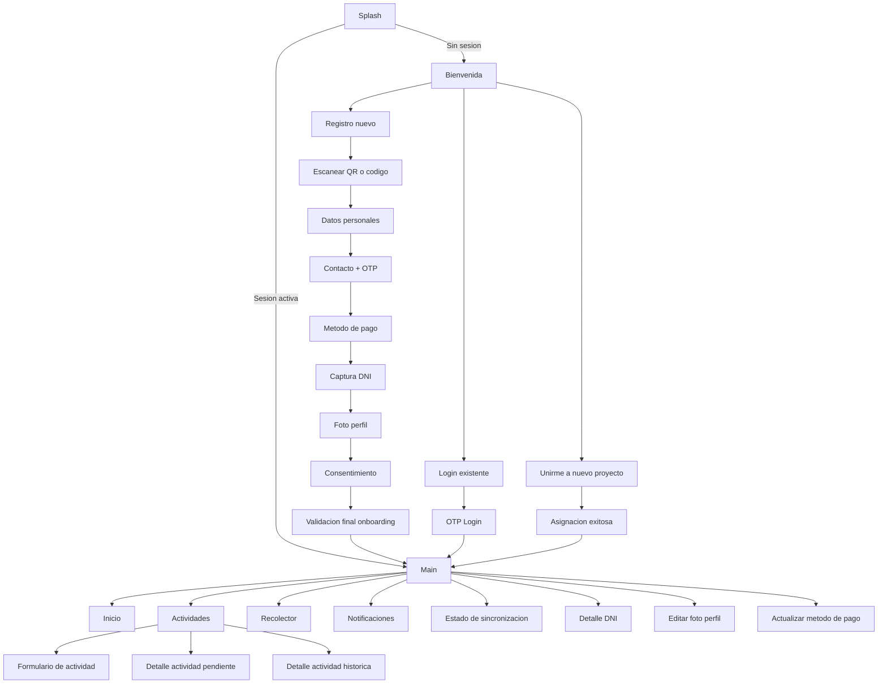
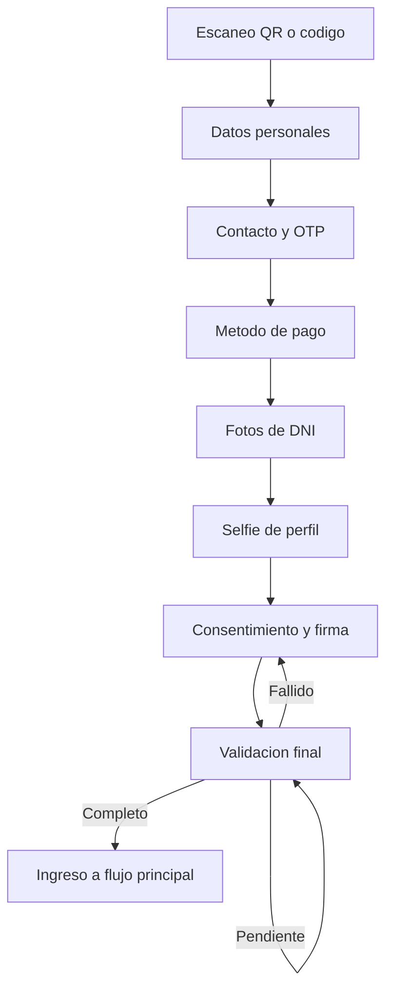

# Mapa de Flujos de la App Pachamama Mobile

## 1. Objetivo de este documento

Este documento describe, de forma funcional y no técnica, todas las vistas identificadas en la app y la lógica de uso que impacta al usuario.

Se usa para construir una guía de usuario detallada:

- Qué puede hacer la persona en cada pantalla.
- Qué condiciones habilitan o bloquean acciones.
- Qué pasa en escenarios normales, sin conexión, con errores o con validaciones.

## 2. Alcance del análisis

Se analizaron las pantallas registradas en la navegación principal y secundaria de la app.

- Flujo inicial y acceso.
- Registro de nuevo recolector (onboarding completo).
- Inicio de sesión de recolector existente.
- Flujo principal con pestañas Inicio, Actividades y Recolector.
- Registro y seguimiento de actividades (incluye borradores, validación de ubicación e historial).
- Notificaciones.
- Edición de perfil (foto, DNI, método de pago).
- Flujo para unirse a un nuevo proyecto.

## 3. Vista general de navegación

## 4. Inventario de vistas y lógica funcional

## 4.1 Flujo de entrada y acceso

### Splash

- Proposito: validar si hay sesion guardada y redirigir.
- Comportamiento:
  - Si existe sesion, entra directo al flujo principal.
  - Si no existe sesion, va a Bienvenida.
- Mensajes visibles: "Inicializando", "Cargando tu perfil", "Preparando tu bienvenida".

### Bienvenida

- Proposito: punto de partida para nuevos y existentes.
- Acciones:
  - "Registrarme por primera vez" -> inicia onboarding.
  - "Ya tengo cuenta" -> inicia login.

### Login

- Datos solicitados:
  - DNI (8 digitos).
  - Ultimos 3 digitos del celular.
- Condiciones visibles:
  - Si no cumple formato, muestra error y no avanza.
  - Si valida, pasa a OTP.

### Login OTP

- Proposito: confirmar identidad para entrar.
- Condiciones:
  - Codigo de 4 digitos.
  - Tiempo de vigencia del codigo.
  - Limite de intentos de validacion.
- Resultado:
  - Exito -> entra al flujo principal.
  - Error/expiracion -> solicita nuevo codigo.

## 4.2 Flujo de registro nuevo recolector (Onboarding)

### Paso 1: Escaneo QR / codigo manual

- Proposito: capturar codigo de invitacion o acceso.
- Condiciones:
  - Requiere permiso de camara para escaneo.
  - Si no hay permiso, se informa que no se puede escanear.
  - Acepta alternativa manual.
- Validaciones:
  - Si el codigo es valido, permite continuar.
  - Si es invalido, muestra error y no avanza.

### Paso 2: Datos personales

- Proposito: validar identidad base.
- Condiciones para avanzar:
  - DNI con longitud valida.
  - Aceptar autorizacion para consulta de DNI.
  - Completar datos requeridos.
- Comportamiento:
  - Si ya hay datos consultados y la persona retrocede, muestra confirmacion para borrar avances.

### Paso 3: Contacto + OTP

- Proposito: verificar numero celular.
- Condiciones:
  - Celular de 9 digitos.
  - Enviar OTP y validar codigo de 4 digitos.
  - Tiempo de vigencia del OTP.
  - Maximo de reenvios.
  - Maximo de intentos de validacion.
- Regla clave:
  - Sin OTP validado no se puede continuar.

### Paso 4: Metodo de pago

- Proposito: definir como recibira pagos.
- Opciones visibles:
  - Efectivo.
  - Giro DNI.
  - Transferencia bancaria.
  - Billetera movil.
- Logica condicional:
  - Si elige transferencia bancaria: pide banco, numero de cuenta y tipo de cuenta.
  - Si elige billetera movil: pide numero, envia OTP y exige validacion OTP.
  - Si no cumple requisitos del metodo elegido, no avanza.

### Paso 5: Captura de DNI (frontal y reverso)

- Proposito: evidencia de identidad.
- Condiciones:
  - Requiere camara.
  - Debe capturar ambos lados para continuar.
- UX:
  - Permite recapturar cada lado.

### Paso 6: Foto de perfil

- Proposito: registrar selfie del recolector.
- Condiciones:
  - Requiere camara.
  - Debe capturar foto para continuar.
- UX:
  - Permite recaptura.

### Paso 7: Consentimiento

- Proposito: aceptacion de tratamiento de datos.
- Condiciones para finalizar:
  - Ver/leer contenido de consentimiento.
  - Marcar aceptacion.
  - Registrar firma.
- Salidas:
  - Exito: envia registro y pasa a validacion final.
  - Cancelacion: regresa al inicio del flujo.

### Pantalla de exito/validacion de onboarding

- Muestra estado final del registro:
  - Pendiente/procesando.
  - Completado.
  - Fallido.
- Cuando completa, habilita continuar al flujo principal.

## 4.3 Flujo principal (Main)

### Contenedor principal con tabs

- Tabs principales:
  - Inicio.
  - Actividades.
  - Recolector.
- Acciones globales:
  - Notificaciones (con indicador de no leidas).
  - Sincronizar (visible especialmente desde Inicio).
  - Menu en Recolector (estado de sincronizacion, editar foto, cerrar sesion).

### Reglas de estado global relevantes

- Si la cuenta llega con estado archivado:
  - Se muestra aviso.
  - Obliga cierre de sesion.
- Si hay cierre de sesion:
  - Retorna a Splash.

## 4.4 Tab Inicio

### Inicio (Home principal)

- Muestra resumen operativo:
  - Proyecto.
  - Estado del proyecto.
  - Comunidad.
  - Brigada/solicitud (si aplica).
- Muestra mapa del area de proyecto.
- Puede indicar:
  - Sincronizando.
  - Error de sincronizacion.
  - Actividades pendientes.

### Mapa del proyecto

- Estados visibles:
  - Inicializando.
  - Cargando.
  - Exito con mapa.
  - Error con opcion de reintentar.
- Incluye opcion de recarga.

## 4.5 Tab Actividades

### Vista principal de Actividades

- Secciones:
  - Pendientes.
  - Historial.
- Boton flotante para "Agregar actividad".

### Condiciones para crear actividad

- Solo se habilita si:
  - La persona esta dentro del area permitida (geocerca).
  - El recolector no esta inactivo.
- Si esta fuera de area:
  - Muestra advertencia con opcion de revalidar.
- Si hay error de ubicacion:
  - Muestra error y permite reintentar.

### Pendientes

- Muestra:
  - Borradores.
  - Actividades pendientes de envio.
  - Estados de envio (pendiente, enviando, enviado, error).
- Acciones:
  - Abrir actividad.
  - Continuar borrador.
  - Eliminar borrador (con confirmacion).
  - Sincronizar todo.

### Reglas de conectividad en Pendientes

- Sin internet:
  - Muestra mensaje de trabajo offline.
  - Los datos quedan guardados para envio posterior.
- Con internet:
  - Habilita "Sincronizar todo" para pendientes.

### Historial

- Filtro por fecha (dia anterior/siguiente, sin pasar de hoy).
- Estados visibles:
  - Cargando historial.
  - Sin internet y sin datos cargados.
  - Error y opcion reintentar.
  - Sin actividades para la fecha.
  - Lista de actividades con estado de validacion.
- Accion:
  - Abrir detalle historico.

### Formulario de actividad (registro)

- Proposito: registrar actividad de inventario o recoleccion.
- Comportamientos clave:
  - Carga dinamica de campos segun tipo/etapa.
  - Guardado automatico de borrador en segundo plano.
  - Guardado manual de borrador.
  - Confirmacion al salir para no perder avances.
  - Eliminacion de borrador con confirmacion.
- Condiciones para registrar:
  - Completar campos obligatorios.
  - Completar codigo de unidad forestal.
  - Validar ubicacion.
- Regla de geocerca al registrar:
  - Dentro de area: registra normalmente.
  - Fuera de area: muestra advertencia y permite decidir continuar o cancelar.

### Adjuntos en formulario

- Soporta captura/adjunto de:
  - Foto.
  - Video.
  - Selfie.
  - Firma.
- Si faltan permisos o hay error en captura, informa al usuario.

### Detalle de actividad pendiente

- Muestra:
  - Informacion general.
  - Respuestas del formulario.
  - Evidencias multimedia.
  - Error de sincronizacion (si aplica) e intentos fallidos.

### Detalle de actividad historica

- Muestra:
  - Fecha de registro.
  - Fecha de sincronizacion.
  - Etapa.
  - Estado de validacion (pendiente/aprobado/rechazado).
  - Respuestas y evidencias.
  - Ubicacion en mapa (si hay coordenadas).

## 4.6 Tab Recolector (Perfil)

### Vista principal de perfil

- Estado de carga: "Cargando tu perfil".
- Estado de error: muestra mensaje funcional.
- Contenido por tabs internos:
  - Datos.
  - Mis Pagos.
  - Mi Comunidad.

### Tab Datos

- Muestra identidad y contacto.
- Permite abrir detalle de DNI.

### Tab Mis Pagos

- Muestra metodo de pago actual y sus datos.
- Permite editar metodo de pago.
- Si no existe configuracion, sugiere agregar.

### Tab Mi Comunidad

- Muestra asignacion (proyecto/comunidad).
- Muestra asignaciones de brigada:
  - Estado cargando.
  - Sin asignaciones.
  - Lista de asignaciones y brigada actual.

### Estados de cuenta visibles

- Activo.
- Inactivo.
- Archivado.

### Cierre de sesion

- Si hay actividades pendientes:
  - Alerta fuerte: advierte perdida de datos locales.
  - Opcion de cancelar o cerrar borrando.
- Si no hay pendientes:
  - Confirmacion simple de cierre.

## 4.7 Vistas de perfil avanzadas

### Detalle de DNI

- Muestra frente y reverso.
- Permite recapturar cada lado con camara.
- Muestra mensajes de carga, error y exito.

### Editar foto de perfil

- Permite capturar nueva selfie.
- Permite guardar cambios.
- Muestra estado guardando y confirmacion de exito.

### Actualizar metodo de pago

- Reglas de validacion:
  - Si es transferencia: banco + cuenta + tipo cuenta.
  - Si es billetera movil: numero valido + OTP validado.
- Sin validaciones completas, boton Guardar deshabilitado.

## 4.8 Notificaciones

- Estados:
  - Cargando.
  - Error.
  - Sin notificaciones.
  - Lista de notificaciones.
- Comportamiento:
  - Al abrir una no leida, se marca como leida.

## 4.9 Estado de sincronizacion

- Muestra detalle de sincronizacion de:
  - Formularios.
  - Mapa del proyecto.
- Estados por modulo:
  - Exito.
  - Cargando.
  - Error.
  - Sin datos.
- Accion principal:
  - "Sincronizar datos".

## 4.10 Unirse a nuevo proyecto (recolector existente)

### Opciones de recolector existente

- Pantalla de decision:
  - Iniciar sesion.
  - Unirme a nuevo proyecto.

### Unirme a nuevo proyecto

- Puede usar QR o codigo manual.
- Requiere ingresar codigo para habilitar accion de union.

### Asignacion exitosa

- Confirma proyecto y comunidad asignados.
- Informa que luego un supervisor completara asignacion de brigada.
- Permite continuar al flujo principal.

## 5. Matriz de condiciones funcionales (resumen rapido)

| Escenario | Condicion | Resultado para usuario |
|---|---|---|
| Primer arranque | Sin sesion | Va a Bienvenida |
| Primer arranque | Con sesion | Va a Main |
| Crear actividad | Fuera de geocerca | Bloqueo inicial + opcion continuar bajo confirmacion |
| Crear actividad | Recolector inactivo | No permite agregar actividad |
| Actividades pendientes | Sin internet | Guarda local y muestra mensaje offline |
| Contacto/Pagos OTP | OTP invalido o expirado | No permite continuar hasta validar |
| Pago tipo billetera | OTP no validado | No permite guardar |
| Salir de formulario | Hay cambios | Ofrece guardar borrador |
| Cerrar sesion | Hay pendientes | Advierte perdida de informacion local |
| Cuenta archivada | Estado archivado | Fuerza cierre de sesion |

## 6. Vistas auxiliares o de soporte detectadas

Estas vistas existen en el codigo y pueden ser de apoyo, legado o pruebas internas:

- HomeScreen2 y HomeScreen3.
- TasksScreen2 y TasksScreen3.
- CameraScreen (flujo de fotos local con reintento).
- SelfieCameraScreen (componente de camara frontal).
- ForestUnitSelectionScreen (selector de unidad forestal en formulario).
- InfoGridScreen (componente de presentacion).

## 7. Recomendaciones para convertir esto en Guia de Usuario final

- Estructurar por perfiles de uso:
  - Nuevo recolector.
  - Recolector con cuenta.
  - Recolector en operacion diaria.
- En cada paso incluir:
  - Objetivo del paso.
  - Que debe hacer el usuario.
  - Que validaciones puede encontrar.
  - Que hacer si aparece un error.
- Agregar capturas por cada hito:
  - Login, OTP, formulario, pendientes, historial, perfil, sincronizacion.
- Incluir seccion FAQ:
  - "No me llega OTP".
  - "Estoy fuera del area".
  - "No tengo internet".
  - "No puedo guardar metodo de pago".
